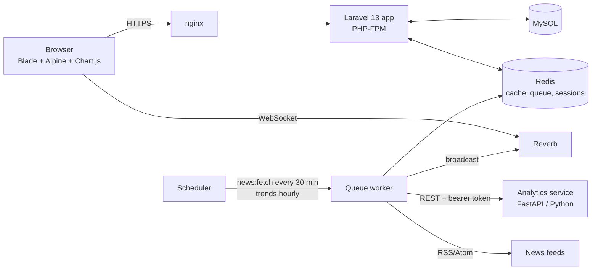

# SoleGlance

**A social network that shows how people feel about the news, and spots public-health signals early.**

SoleGlance combines a social network (profiles, friends, posts, real-time
chat) with news ingestion, trending-topic dashboards, multilingual sentiment
analysis and **public-health signal detection** for **English, Nigerian
Pidgin, Urdu and Roman Urdu**, focused on Nigeria and Pakistan. Users can see what
is trending, how positively or negatively each topic is being discussed
over time and by region, and download a PDF report for any topic.

The project began as a final-year BS Software Engineering project at Riphah
International University (2022) and was rebuilt and extended in 2026 (v2).
See [Project history](#project-history).

---

## Features

| Area | What it does |
|---|---|
| Accounts & profiles | Registration with email verification, usernames (`/@username`), bio, photo, location |
| Posts | Text, images and video; audience of *public*, *friends*, *only me* or *specific friends*; reactions and comments; edit/delete |
| Friends | Requests, accept/decline/cancel, unfriend, "people you may know" |
| Chat | One-to-one real-time messaging between friends over WebSockets (Laravel Reverb), message deletion, per-user "delete chat", in-conversation search |
| Notifications | Friend requests, acceptances, reactions, comments, account suspension (also by email) |
| News | Admin-managed RSS/Atom sources, fetched every 30 minutes |
| Trending | Burst-detected trending terms from public posts and news, by category, with a sentiment breakdown |
| Topic analysis | Sentiment over time for any keyword, with date-range and region filters |
| Sentiment analyser | Paste any English/Urdu/Roman Urdu text and see the model's estimate |
| Reports | Downloadable PDF topic reports |
| Health signals | Disease/symptom mentions in public posts and news (4 languages, region-resolved), daily outbreak early warning (CDC EARS C1-C3) with e-mail, in-app and signed-webhook alerts to health officers |
| Misinformation review | Likely false health claims on public posts go to a human review queue; confirmed items show a fact-check under the post (never auto-removed) |
| Learning loop | Users and moderators correct labels; corrections retrain models automatically behind a promotion gate; versioned model registry with rollback; drift monitoring (PSI) |
| Administration | Dashboard, suspend/reinstate/delete users, hide posts, manage news sources, model operations, audit log |

Privacy by design: analytics (trends, topic pages, reports) only ever use
**public** posts and news articles. Friends-only, custom-audience and
private posts never leave the visibility rules enforced by `Post::visibleTo`.

## Architecture



* **Web app** (`app/`, `resources/`, `routes/`): Laravel 13, Blade, Tailwind CSS, Alpine.js.
* **Analytics service** (`analytics/`): FastAPI service for language identification,
  sentiment, topic categories and trend detection. Laravel calls it from queued jobs, so
  the site keeps working (without new sentiment labels) if it is down.
* **Models** (`analytics/research/`): reproducible training and evaluation scripts.

## Quick start (Docker)

Requirements: Docker with Compose.

```bash
cp .env.example .env
# Set APP_KEY (see below), DB_PASSWORD, ANALYTICS_TOKEN, REVERB_APP_* and MAIL_* values in .env
docker compose run --rm app php artisan key:generate --show   # paste into APP_KEY
docker compose up -d --build
docker compose exec app php artisan migrate --force
docker compose exec app php artisan db:seed --force            # creates the admin (ADMIN_EMAIL / ADMIN_PASSWORD)
```

Open <http://localhost:8000>. Add news sources in **Admin → News sources**.

The analytics container needs trained model files in `analytics/models/`
(see [Analytics models](#analytics-models)). Without them it falls back
to the ensemble, then the TF-IDF model, then VADER. On first start it downloads
about 1.5 GB of pretrained weights, so allow a few minutes before it reports healthy.

## Local development

Requirements: PHP 8.3+, Composer, Node 20+, Python 3.11+.

```bash
composer install
npm install && npm run build
cp .env.example .env && php artisan key:generate
touch database/database.sqlite && php artisan migrate --seed
php artisan db:seed --class=DemoSeeder        # optional fictional demo users and posts
composer run dev                               # app, queue, logs and Vite together
php artisan reverb:start                       # real-time chat
```

Analytics service:

```bash
cd analytics
python -m venv .venv && . .venv/bin/activate   # Windows: .venv\Scripts\activate
pip install torch --index-url https://download.pytorch.org/whl/cpu
pip install -e ".[research,dev]"
uvicorn soleglance_analytics.app:app --port 8001
```

Set `ANALYTICS_URL=http://localhost:8001` and the same `ANALYTICS_TOKEN` in both places.

## Analytics models

| Component | Method |
|---|---|
| Language ID | Script detection, then a character n-gram classifier for Latin-script text (`en`, `pcm`, `ur-Latn`); `ur` for Perso-Arabic script |
| Sentiment (default `routed`) | Per-language model chosen on validation data: XLM-T for English, word + character n-gram TF-IDF with logistic regression for Roman Urdu, and an ensemble with frozen multilingual MiniLM embeddings for Urdu |
| Baselines | TextBlob (used by the 2022 prototype), VADER, zero-shot XLM-T |
| Topic category | Keyword lexicons + embedding prototypes (zero-shot) |
| Trends | Poisson burst score `(c - mu) / sqrt(mu + 1)` over unigrams and bigrams, current window vs. history |
| Health mentions | Multilingual disease/symptom lexicon + gazetteer (36 Nigerian states + FCT, 7 Pakistani provinces/territories) gated by a classifier trained on RHMD over multilingual embeddings |
| Health misinformation | Classifier trained on Constraint@AAAI 2021 (English) and Bend-the-Truth (Urdu) |
| Outbreak signals | EARS C1/C2/C3 and Poisson aberration detection over daily mention counts per disease and region |

Train and evaluate (downloads public datasets into `analytics/research/cache/`):

```bash
cd analytics
python -m research.train            # writes models/*.joblib
python -m research.train_routing    # language identifier + per-language model choice
python -m research.train_health     # health-mention and misinformation classifiers
python -m research.evaluate         # sentiment + language ID -> research/results/
python -m research.evaluate_topics  # AG News topic accuracy
python -m research.evaluate_trends  # injected-burst trend detection
python -m research.evaluate_health  # health mentions, misinformation
python -m research.evaluate_surveillance   # retrospective early warning vs NCDC / OpenDengue data
python -m research.evaluate_feedback_loop  # simulated human-in-the-loop adaptation (active learning)
```

Datasets and licences are listed in [`analytics/research/datasets.py`](analytics/research/datasets.py).
Results reported in the accompanying paper are in `analytics/research/results/`.

## Health partners

Give a user the `health_officer` role (in `php artisan tinker`:
`User::where('email', '...')->first()->forceFill(['role' => 'health_officer'])->save();`).
Health officers receive outbreak alerts, can acknowledge or resolve them, and
review flagged misinformation. To push alerts to another system, set
`HEALTH_ALERT_WEBHOOK` and `HEALTH_WEBHOOK_SECRET`. Each alert is POSTed as JSON
with an `X-SoleGlance-Signature: HMAC-SHA256(body, secret)` header.

Alerts are automated signals from public content, not confirmed outbreaks.
SoleGlance is not a diagnostic tool and makes no inferences about individuals.

## Model operations

```bash
docker compose exec analytics python -m soleglance_analytics.mlops registry
docker compose exec analytics python -m soleglance_analytics.mlops retrain sentiment_tfidf
docker compose exec analytics python -m soleglance_analytics.mlops rollback sentiment_tfidf v1
```

## Tests

```bash
php artisan test                     # web app (Pest)
cd analytics && pytest               # analytics service
```

## Security

* Authorisation: policies for posts, comments, conversations and reports; `admin` gate; suspended users are signed out.
* Uploads are validated by content and stored under random names; the web server never executes files in `storage/`.
* Chat bodies are rendered with `textContent` / Blade escaping; RSS parsing never fetches external entities.
* Rate limits on posting, messaging, reactions and report generation.
* The analytics API requires a bearer token.

Please report vulnerabilities privately to the maintainers rather than in a public issue.

## Project history

* **2022, v1:** Final-year project, *SoleGlance*, BS Software Engineering, Faculty of
  Computing, Riphah International University, Islamabad (supervisor: Ms. Alia Fatima).
  Laravel 8 prototype with standalone Python/Tweepy sentiment scripts.
* **2026, v2:** Rebuilt on Laravel 13 with a new UI. Implements the chat, trending,
  sentiment, reporting and administration modules specified in the dissertation, plus a
  multilingual analytics service, a security review and a test suite.

## Citation

If you use SoleGlance in research, please cite it using [`CITATION.cff`](CITATION.cff).

## Licence

[MIT](LICENSE). Third-party datasets and pretrained models keep their own licences.
